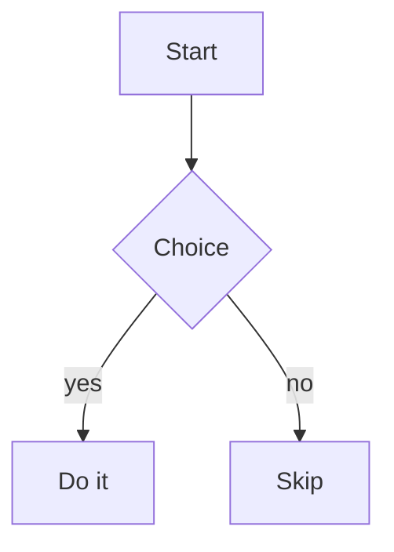

# Document Title

A paragraph with **strong**, *emphasis*, ~~strikethrough~~, `inline code`, and
a [link to a heading](#document-title). An autolink: <https://example.com>.

## Lists

Unordered:

- First
- Second
  - Nested
- Third

Ordered:

1. One
2. Two
3. Three

Task list:

- [ ] Not done
- [x] Done

## Blockquote

> A quote spanning
> two lines.

## Table

| Fruit  | Count | Price |
|:-------|:-----:|------:|
| Apples |   3   | 1.50  |
| Pears  |  12   | 4.00  |

## Fenced code

```rust
fn main() {
    println!("hello");
}
```

## Alert

> [!WARNING]
> Be careful here.

## Math

Inline math $E = mc^2$ appears within a sentence, and a display equation is set
on its own line:

$$\int_0^1 x^2 \, dx = \frac{1}{3}$$

## Diagram



## Footnote

This claim needs a source.[^src]

[^src]: The supporting reference.
