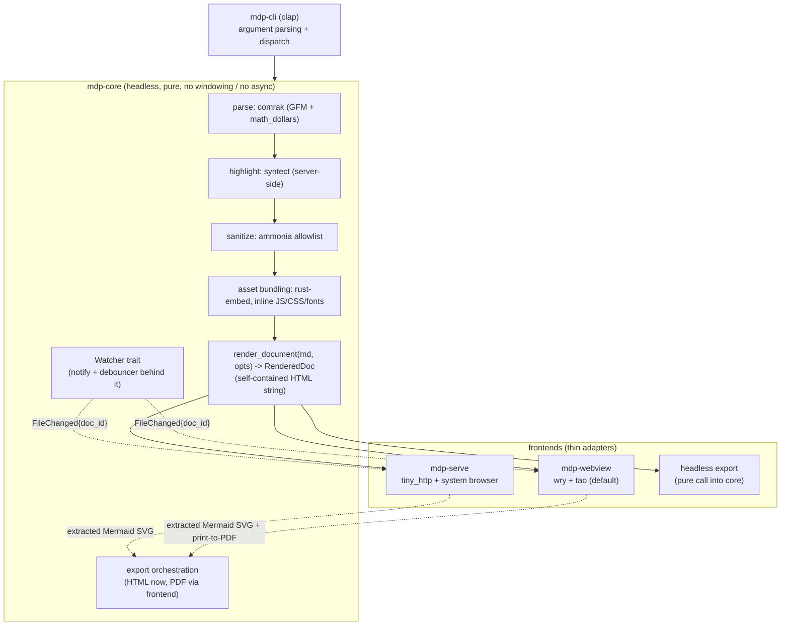

# markdown-previewer: Technical Design Document

## 1. Overview and goals

markdown-previewer (`mdp`) is an elegant, fast-launching Markdown previewer written in Rust. You point it at one or more Markdown files from the command line and it opens straight into a rendered, read-only preview. It is designed to be launched by a human at a terminal and to be called by other tools (including Claude Code) to display Markdown to a user.

Goals, in priority order:

1. Render Markdown faithfully: GFM (tables, task lists, alerts/admonitions, footnotes), math (KaTeX), diagrams (Mermaid), and syntax-highlighted code.
2. Launch feels instant: a window or browser tab appears immediately with a loading state, then the rendered content swaps in.
3. Read-only by contract, with a read-only "view source" toggle.
4. Offline export to self-contained HTML and to PDF, preserving rendered diagrams and math.
5. Unobtrusive file watching: when a tracked file changes, prompt to reload; never yank the reader's view.
6. Cross-platform (macOS, Linux, Windows), a single binary where the OS allows it, MIT licensed, with every shipped dependency license-compatible.

Non-goals: editing, live collaboration, a plugin system, or a general-purpose static-site generator.

## 2. Architecture

The design separates a display-agnostic **core** from three thin **frontends**. The core does all the load-bearing work and is where test coverage concentrates. Frontends are adapters that consume one deterministic product of the core: a fully self-contained HTML string.



Crate layout (cargo workspace, `resolver = "3"`):

| Crate | Kind | Responsibility |
|---|---|---|
| `mdp-core` | lib | Markdown to self-contained HTML, sanitization, asset inlining, file-watch abstraction, export orchestration. No windowing, no tokio, no wry. Coverage target lives here. |
| `mdp-cli` | bin (`mdp`) | clap parsing; dispatches to a frontend behind cargo features. The single shipped binary. |
| `mdp-webview` | lib (feature `webview`) | wry/tao native window frontend. |
| `mdp-serve` | lib (feature `serve`) | tiny_http local server + system browser frontend. |

The headless export mode is not a crate; it is a pure call into `mdp-core` plus (for PDF) a print step delegated to a frontend that owns a browser engine.

**The load-bearing rule:** `mdp-core` exposes `render_document(markdown: &str, opts: &RenderOptions) -> RenderedDoc`, where `RenderedDoc` holds a fully self-contained HTML string (all JS, CSS, and fonts inlined). Every frontend consumes that same string. Separate crates enforce the boundary at compile time: a frontend physically cannot leak windowing dependencies into the core.

## 3. Technology choices

One answer per decision. Where the research findings disagreed, the reconciliation is called out below the table.

| Concern | Choice | Version | License | Why |
|---|---|---|---|---|
| Markdown parse + render | `comrak` | 0.54.0 | BSD-2-Clause | Native GFM alerts/admonitions and footnotes, which the spec requires; `math_dollars` passthrough for KaTeX. |
| HTML sanitization | `ammonia` | 4.1 | MIT OR Apache-2.0 | html5ever DOM-rebuild allowlist; the real security boundary for raw HTML in Markdown. |
| Syntax highlighting | `syntect` (`default-fancy`) | 5.x | MIT | Pure-Rust (fancy-regex, no Oniguruma C dep); highlight once in core so preview and export are byte-identical. |
| Math rendering | KaTeX (bundled JS/CSS/fonts) | 0.16.x (maintained line) | MIT | Synchronous render, no reflow flash, ~328 KB self-hosted, inlines cleanly for export. |
| Diagrams | Mermaid (bundled full UMD build) | 11.16.0 | MIT | Only viable offline diagram engine; render in-page and extract SVG for export. |
| Native webview | `wry` + `tao` | wry 0.55.1 | MIT OR Apache-2.0 | Custom protocol for offline assets, IPC handler, exposes native handles for print-to-PDF. Uses the OS engine, so nothing is bundled on macOS/Windows. |
| macOS PDF FFI | `objc2` + `objc2-web-kit` | current | MIT OR Apache-2.0 | `WKWebView.createPDF` (macOS 11+), dialog-free. |
| Windows PDF FFI | `webview2-com` + `windows` | current | MIT OR Apache-2.0 | `ICoreWebView2_7::PrintToPdf`, paginated, dialog-free. |
| Linux PDF FFI | `webkit2gtk` (binding) | current | MIT | `PrintOperation` with output-uri, paginated, dialog-free. |
| File watching | `notify` + `notify-debouncer-full` | notify 8.2.0, debouncer 0.7.0 | CC0-1.0 / MIT OR Apache-2.0 | Cross-platform; debouncer stitches rename events and coalesces the save-event storm. Depend on the debouncer and use its re-exported `notify`. |
| Asset embedding | `rust-embed` | 8.11.0 | MIT | Folds `assets/` into the binary in release, reads from disk in dev for fast iteration. |
| CLI parsing | `clap` (derive) | 4.6.x | MIT OR Apache-2.0 | Subcommand-or-default-path design; free `--help` and completions. |
| Local HTTP server | `tiny_http` | 0.12.0 | MIT OR Apache-2.0 | One page plus a reload-signal endpoint; synchronous, no tokio, keeps launch fast and binary lean. |
| Browser launcher | `webbrowser` | 1.2.1 | MIT OR Apache-2.0 | Guarantees a real browser (not a registered editor), non-blocking, suppresses browser stdio. |
| Config file | `toml` + `serde` | current | MIT OR Apache-2.0 | Optional `config.toml` for persistent defaults (default theme path, color scheme). |
| Config dir | `directories` | current | MIT OR Apache-2.0 | Locate the platform config dir cross-platform without heavy deps. |
| Coverage (dev) | `cargo-llvm-cov` | 0.8.7 | MIT OR Apache-2.0 | Accurate source-based instrumentation, covers doctests. Not shipped. |
| Snapshot tests (dev) | `insta` + `cargo-insta` | 1.4x | Apache-2.0 | Review-friendly HTML snapshots with redactions for inlined asset blobs. Not shipped. |
| Test fixtures (dev) | `tempfile` | current | MIT OR Apache-2.0 | Real temp files for watch/export end-to-end tests. |
| CLI e2e (dev) | `assert_cmd` + `trycmd` | current | MIT OR Apache-2.0 | Drive the real binary in headless/export mode. |
| License gate (dev) | `cargo-deny` | current | MIT OR Apache-2.0 | Enforce the license allowlist across the full transitive tree in CI. |

**Reconciled conflicts:**

- **comrak vs pulldown-cmark.** Findings 1 and 5 disagreed. We choose **comrak**. The spec explicitly lists alerts/admonitions and footnotes; comrak has both natively, while pulldown-cmark would require hand-rolling alerts and emits only an event stream (more glue). pulldown-cmark's speed edge is irrelevant here because launch cost is dominated by the webview engine and the bundled JS assets, not Markdown parsing. Cost accepted: we carry comrak's BSD-2-Clause notice specifically (not everything is MIT), and we pin the exact version because comrak's extension field names have churned across releases.
- **KaTeX vs MathJax.** KaTeX, both findings agree. Smaller, synchronous, trivial to inline. MathJax stays a documented opt-in only if a user hits a KaTeX macro gap.
- **syntect (server-side) vs highlight.js (client-side).** syntect. Highlighting in the core removes a client code path and makes preview and export identical, and it works even in a no-JS export.
- **tiny_http vs axum.** tiny_http. The serve frontend is one page plus a reload signal; axum/tokio/tower would bloat the binary and slow launch for no benefit at this scale.

## 4. Feature design

### 4.1 Rendering pipeline

`render_document` is a pure `&str -> RenderedDoc` transform with no I/O:

1. **Parse and render** with comrak. Enabled extensions: `table`, `tasklist`, `strikethrough`, `autolink`, `tagfilter`, `footnotes`, `alerts`, `math_dollars` (optionally `math_code`). `render.unsafe_` stays **off** (default), so raw inline HTML is escaped or suppressed and tagfilter neutralizes the dangerous GFM tag set. Math is left as `$...$` / `$$...$$` wrappers for KaTeX to pick up client-side; comrak does not render math itself.
2. **Highlight code server-side** with syntect. Fenced blocks get highlighted HTML with class-based styling emitted at core time. The one exception is `mermaid` fences: those pass through as `<pre><code class="language-mermaid">` for the client-side Mermaid step.
3. **Sanitize** the full HTML output with ammonia as the authoritative security step. The allowlist is tuned to keep exactly what comrak and syntect emit: table markup, `input[type=checkbox][disabled]` for task lists, alert `div`s, footnote anchors and backrefs, the math wrapper spans, the `language-mermaid` class, and syntect's highlight classes. Everything else (`script`, `style`, event handlers, `javascript:` URLs, `iframe`) is stripped. This allowlist is the single most delicate config in the project and gets its own adversarial test corpus (see section 7).
4. **Assemble** the self-contained page: the sanitized body plus inlined KaTeX (CSS with base64 `data:` woff2 fonts, JS, auto-render init), inlined Mermaid (initialized `startOnLoad:false`, `securityLevel` set conservatively), the syntect theme CSS, and the app's own CSS/JS shell. The result is one HTML string with zero external references.

Client-side, on load: the shell runs KaTeX auto-render over the math wrappers, then `mermaid.render()` over each `language-mermaid` block, then fires a `render-complete` IPC signal (used by export, section 4.5).

### 4.2 Read-only preview and view-source toggle

The preview is read-only by construction: it is rendered HTML in a webview or browser with no editing affordances, no form posts, and a sanitized DOM. The "view source" toggle swaps the body between the rendered view and the raw Markdown shown as escaped text inside a `<pre>` (also read-only). The toggle is driven entirely client-side over IPC (native frontend) or a small script (serve frontend); it never re-fetches or mutates the file. Toggling preserves scroll position where practical.

### 4.3 File watching and smart reload UX

The watcher lives behind a `Watcher` trait in the core (real impl wraps `notify` + `notify-debouncer-full`; tests inject synthetic events).

- **Watch the parent directory** of each tracked file, non-recursive, and filter events down to a `HashSet` of canonicalized tracked paths. This is the fix for the atomic-rename save pattern (vim, VS Code, JetBrains write a temp file and rename over the original, unlinking the inode); a watch on the file path itself dies after the first save, a watch on the directory does not.
- **Group by parent directory** so many files in one folder cost one OS watch. Map each matched event back to its `doc_id`.
- **Debounce** at ~300 ms (validate against real editor save patterns) to coalesce the 3 to 12 raw events per save into one logical change. The debouncer's rename stitching and filesystem-ID tracking handle the temp-file dance.
- **Optionally hash content** so metadata-only touches do not surface a prompt.

On a debounced change the core emits a lightweight `FileChanged { doc_id }` message. The frontend shows a dismissible, non-intrusive banner ("This file changed on disk. Reload"). It **never auto-swaps content**, preserving the reader's scroll and any open view-source toggle until they opt in. This is the spec's "do not yank the view" requirement.

Watch limits are documented: Linux `inotify` has a per-user watch cap (mitigated by directory-not-tree watching), and network filesystems (NFS, SMB, some bind mounts) do not deliver reliable events. For those, `notify::PollWatcher` (same API) is offered as an opt-in fallback.

### 4.4 HTML export

The self-contained HTML string the core already produces is the export product, with one addition: rendered Mermaid diagrams are frozen to static SVG. A frontend that owns a browser engine renders the page, and the finished SVG is extracted from the DOM (over IPC in the webview, or a small POST-back shim in the serve frontend) and inlined into the exported HTML in place of the `mermaid` code block. Math is already inlined via KaTeX CSS plus base64 fonts. The result is a single file that opens with zero network calls. This is fully offline, fully deterministic to assemble, and self-testable (see the offline-URL scan test in section 7).

### 4.5 PDF export

PDF is the hardest requirement because rendered Mermaid and KaTeX need a live JS/DOM engine; no pure-Rust HTML-to-PDF path can reproduce them. wry deliberately does not expose silent print-to-PDF (only `WebView::print()`, which opens a modal dialog). But wry does expose the native handle on all three platforms, and each platform has a maintained, offline, dialog-free PDF API. We wrap these behind one `PdfExporter` trait with three `#[cfg(...)]` impls:

| Platform | Handle | API | Notes |
|---|---|---|---|
| macOS | `WebViewExtMacOS::webview()` (WKWebView subclass) | `createPDFWithConfiguration:completionHandler:` via objc2 | Easiest; a few lines. Captures as one tall page unless `WKPDFConfiguration.rect` is set; does not auto-paginate to Letter/A4. |
| Windows | `WebViewExtWindows::controller()` -> `ICoreWebView2_7` | `PrintToPdf(path, settings, handler)` via webview2-com | Async; pump completion on the message loop. Paginates and honors margins/orientation/background. |
| Linux | `WebViewExtUnix::webview()` (webkit2gtk WebView) | `PrintOperation` with output-uri `file:///abs.pdf`, output-format `pdf` | Runs with no dialog. Paginates. |

**Ordering and timing.** The exporter must wait for the JS `render-complete` signal (KaTeX finished, Mermaid `run()` resolved) before capturing, or the PDF captures a half-rendered page. This ordering is an integration-test fragility point and must be proven empirically.

**Fallback.** If a platform's FFI path proves problematic, fall back to wry's built-in `WebView::print()` and let the user pick "Save as PDF" / "Microsoft Print to PDF" / print-to-file. It works everywhere today with zero FFI; it is simply not one-click. We ship the FFI path as primary and keep `print()` wired as the guaranteed fallback.

**Pagination is not uniform.** macOS `createPDF` yields one tall page; Windows and Linux paginate. We normalize as far as a print stylesheet (`@page`) allows and accept that macOS single-page output may differ until (or unless) we invest in the harder `NSPrintOperation` route. This is called out as a spike, not assumed solved.

**PDF is out of scope for core coverage.** The testable deterministic unit is "produce the correct self-contained HTML the engine will print." That we snapshot. PDF fidelity is an integration test behind the `webview` feature.

### 4.6 Theming and branding

Visual identity is a theme layer, not hardcoded style. This is the mechanism that makes branding customizable.

- The layout and prose CSS reference only **semantic tokens** (`--accent`, `--text-body`, `--text-heading`, `--surface-page`, `--surface-card`, `--font-body`, `--font-heading`, `--font-mono`, `--space-*`, `--radius-*`). No raw brand color or brand name ever appears in the layout CSS. This is the one thing we deliberately do differently from the sherpas-docs `docs.css`, which leaks raw brand tokens (e.g. `--color-pacific-blue`) directly into layout rules.
- A **theme is a small CSS file** that sets those tokens under `:root` (plus optional `@font-face` and an optional logo/header block). To rebrand, a user overrides only the variables they care about; everything else inherits from the built-in default. There is no bespoke theme config language to learn.
- The tool ships exactly one built-in theme: a **neutral, elegant default** that is the tool's own identity, using OFL-licensed fonts. No company branding is bundled, keeping the MIT artifact free of third-party brand IP.
- `mdp --theme <path.css>` layers a user theme over the default (default tokens load first, then the user file, so partial overrides work). A config file (section 6) can set a default theme path so the flag is not needed day to day.
- A light/dark color scheme (`--dark`/`--light`/`--auto`) is orthogonal to the theme: the default theme and any well-formed custom theme define both schemes via `prefers-color-scheme`, and the flag can force one.

The Sherpas look is intentionally **not** in this repo. It lives as a private theme CSS file in the user's own space (for example `~/.config/mdp/themes/sherpas.css`) and is selected with `--theme`. That file is a straight port of the `sherpas-brand` tokens onto the tool's semantic token names, and is the natural path to eventually retiring the pandoc-based `sherpas-docs` render flow in favor of this tool (which, unlike that flow, renders Mermaid and math).

## 5. Offline asset strategy

Hard constraint: no runtime network calls. Everything ships inside the binary.

**What is embedded** (an `assets/` directory folded in by rust-embed):

- KaTeX: `katex.min.js`, `katex.min.css`, and the 20 `KaTeX_*.woff2` fonts. The CSS references fonts by relative `url("fonts/KaTeX_*.woff2")`, which is a known footgun: the serve frontend must serve those relative paths, and both HTML and PDF export must inline the woff2 as base64 `data:` URIs inside `@font-face`. An explicit test asserts math renders rather than showing boxes.
- Mermaid: the full prebuilt UMD/ESM bundle (`mermaid.min.js`), not a loader that dynamic-imports diagram modules. This is the single largest asset (several MB uncompressed; re-measure the pinned 11.16.0 build rather than trusting the older ~2.8 MB figure). Stored gzip-at-rest in rust-embed; Mermaid init is lazy, only when a `mermaid` fence exists.
- syntect theme CSS (highlighting is done in Rust, so no highlighter JS ships).
- The neutral default theme's fonts and the app shell CSS/JS. The default theme uses OFL-licensed fonts (permissive and safe to ship); no company logo or brand identity is embedded (see section 4.6). The shell CSS is written against semantic tokens only, so a `--theme` override is a complete rebrand surface.

**How it is used.** In dev, rust-embed reads from disk for fast iteration; in release it serves from the binary. The webview frontend serves assets through a wry custom protocol (`mdprev://localhost/...`) with correct MIME types; the serve frontend serves the same bytes over tiny_http; export inlines them directly into the HTML.

**Offline is enforced by test,** not by convention: a test scans generated and exported HTML for `http(s)://` and protocol-relative `//` references and fails if any appear.

License housekeeping: a bundled third-party-licenses file aggregates every NOTICE/LICENSE (comrak's BSD-2-Clause text specifically, KaTeX, Mermaid, syntect grammar/theme attributions, the font). `cargo-deny` enforces the allowlist in CI.

## 6. CLI design

A "subcommand-or-default-path" surface so the common case has zero ceremony. The file path is a top-level positional; subcommands are optional.

```
mdp <FILE>...                      open the default webview preview
mdp view   <FILE>... [--frontend webview|serve]
mdp serve  <FILE>... [--port 0] [--no-open]
mdp export <FILE>  --to <out.html|out.pdf>
```

Global flags:

```
--no-watch                 disable file watching
--theme <path>             theme CSS file layered over the built-in default
--dark | --light | --auto  color scheme (default: auto)
--view-source-default      open showing raw source instead of rendered
```

Examples:

**Primary CLI use** (human at a terminal):

```
# open a rendered, read-only preview in a native window
mdp README.md

# preview several files
mdp docs/intro.md docs/setup.md

# force the browser-based frontend, no watching
mdp view --frontend serve --no-watch NOTES.md
```

**Claude-Code / headless use.** For a robust, display-agnostic display path that works without a native webview and does not block, use the serve frontend on an ephemeral port and let the calling tool open or surface the URL:

```
# start a local server, print the URL, do not auto-open a browser
mdp serve --port 0 --no-open GENERATED.md
#   -> prints: http://127.0.0.1:53017/

# fully headless: no window, no browser, just write a self-contained file
mdp export report.md --to report.html
mdp export report.md --to report.pdf
```

The serve frontend binds `127.0.0.1:0`, reads back the assigned port (so multiple previews never collide), and is the designed fallback when the native webview is unavailable.

**Config file.** An optional `config.toml` in the platform config dir (`~/.config/mdp/` on Linux/macOS, `%APPDATA%\mdp\` on Windows) sets persistent defaults, most usefully `theme = "~/.config/mdp/themes/sherpas.css"` so a branded look is the standing default without passing `--theme` each time. CLI flags override the config file.

## 7. Testing strategy

Coverage concentrates in `mdp-core`, where the logic is a pure string-to-string transform with no windowing or async. Frontends are deliberately thin glue and are excluded from the coverage target. CI gates on `mdp-core` coverage only (`cargo llvm-cov --package mdp-core`) so frontend glue does not distort the number.

**Snapshot-tested (insta).** The rendered HTML from `render_document` over a fixture corpus: tables, fenced code in several languages, a Mermaid block, inline and display math, task lists, GFM alerts, footnotes, and a titled document. Because the HTML embeds large JS/CSS blobs, snapshots capture a normalized view: the Markdown-derived body plus which asset hooks are injected, with insta redactions blanking the vendored KaTeX/Mermaid source so snapshots stay reviewable and stable across asset bumps.

**Sanitization corpus.** A dedicated adversarial-plus-feature test set run through the full comrak -> ammonia pipeline, asserting both that malicious HTML (script injection, `javascript:` URLs, event handlers, obfuscated payloads) is removed and that every legitimate feature's markup survives (alert divs, task-list checkboxes, footnote anchors, math wrappers, mermaid and highlight classes). This is treated as a spike to run before the ammonia allowlist is locked.

**Offline-URL scan.** A test asserts no `http(s)://` or protocol-relative reference appears in generated or exported HTML.

**File watching, end to end.** Using `tempfile`: create a real temp `.md`, start the core watcher, write to the file, and assert a `FileChanged` event arrives on the channel within a timeout. Test debounce/coalescing and the "emit reload-prompt signal, do not swap content" state transition at the core level (the prompt is just a state flag the frontend renders). Because the watcher sits behind a trait, fast deterministic unit tests feed synthetic events with no real filesystem; these are the primary coverage, with the real-FS test as a slower integration check (timing-sensitive and platform-dependent, so generous timeouts).

**Export, end to end (headless).** Call export to a tempdir and re-run the offline-URL scan on the written file; assert self-containment.

**CLI, end to end.** `assert_cmd` plus a small `trycmd` corpus drives the real `mdp` binary in headless/export mode against fixtures, asserting exit codes and generated files. This covers the clap wiring without a display.

**Left thin (intentionally excluded from the coverage target):** the webview and serve adapters, the print-to-PDF FFI, and PDF fidelity. PDF cannot be self-tested by the core because Mermaid and KaTeX need a live browser engine; PDF is validated as a feature-gated integration test (webview feature, or a headless browser in CI), and the honest core-level unit is "produce the correct self-contained HTML the engine will print."

**License enforcement.** `cargo-deny` in CI is the authoritative check on the full transitive license tree; the versions named here were verified individually but the complete tree is proven by the gate, not by hand.

## 8. Risks and open questions, ranked

Ranked by how much they threaten the design and how early they should be resolved. The top three warrant a spike before committing significant implementation.

1. **Cross-platform one-click PDF (spike first).** wry has no silent print-to-PDF; we reach three different native APIs. macOS is a few lines; Windows (async completion handler) and Linux (GTK PrintSettings URI/format) each need real plumbing, and pagination differs (macOS single tall page vs paginated elsewhere). Spike: prove all three produce a faithful multi-page PDF of a doc containing a Mermaid diagram and display math, and settle the macOS pagination question. HTML export (fully working, fully offline) is the guaranteed fallback if PDF slips.
2. **The "render-complete" signal for export (spike first, coupled to #1).** Export must wait until KaTeX and Mermaid have finished before capturing, or it snapshots a half-rendered DOM. This needs a reliable injected JS hook (Mermaid `run()` promise plus KaTeX completion) and empirical verification. It is the main fragility point in both PDF and frozen-SVG HTML export.
3. **ammonia allowlist tuning (spike first).** Too strict silently breaks alert divs, task checkboxes, footnotes, or math wrappers; too loose lets something through. Also verify empirically that comrak's `math_dollars` output tag/class survives ammonia and matches the KaTeX auto-render selector, and that `language-mermaid` and syntect classes survive. Lock the config only after the adversarial-plus-feature corpus passes.
4. **Headless PDF on Linux.** A webview needs a display server, so headless PDF export on a Linux CI runner likely needs xvfb or an offscreen surface. This partially undercuts a "pure headless" story on Linux and needs a spike; the serve fallback does not help here because browsers block silent printing.
5. **Linux WebKitGTK runtime dependency.** wry links `libwebkit2gtk-4.1` (soup3; 4.0/soup2 is being removed from newer distros). It cannot be cleanly statically bundled. Mitigations: document exact per-distro install commands; at startup, if the webview fails to init, print the missing package name and automatically fall back to the serve frontend; optionally ship a Flatpak/AppImage that bundles the runtime. macOS and Windows remain true single binaries (WebView2 is an OS/Evergreen component on modern Windows).
6. **Bundle size dominated by Mermaid.** Several MB uncompressed. Acceptable for a desktop tool; mitigated by gzip-at-rest and lazy init. Re-measure the pinned 11.16.0 build rather than trusting the older figure.
7. **Startup latency from webview engine init.** The tao window appears near-instantly, but engine init and first paint are non-trivial (WebView2 cold init commonly ~600 to 800 ms; a recent wry GTK first-render regression exists). Mitigation: the custom protocol serves a tiny inline spinner page on the very first request, before the core finishes rendering; content swaps in without a white flash. Avoid creating the webview while the window is hidden on Windows.
8. **Version churn.** comrak (frequent breaking releases, renamed extension flags), wry (handle types have changed across versions), Mermaid (breaking bundle/API changes across majors), and the recent `notify-debouncer-full` 0.7.0 (MSRV 1.85). All pinned to exact versions; re-verify APIs on any upgrade.
9. **Debounce window feel.** 300 ms is a starting point; validate against real vim / VS Code / JetBrains save patterns before calling it done.
10. **Path canonicalization in the watch filter.** Symlinks, `./` prefixes, and case-insensitive filesystems on macOS/Windows must be normalized to avoid both misses and false positives; needs a small test matrix.

## 9. Phased implementation plan

Each phase is small and independently verifiable. Phase 1 is the smallest thing that renders and displays.

**Phase 1: static render to a window.** `mdp-core::render_document` for plain CommonMark plus GFM tables and code (comrak, no math/mermaid yet), ammonia sanitization, and the self-contained HTML assembly. `mdp-webview` opens a window, serves the HTML through the wry custom protocol behind a spinner shell, and swaps in the content. The app shell CSS is token-based (semantic CSS variables) with the neutral built-in default theme from the very first commit, so nothing hardcodes a brand. `mdp README.md` shows a rendered, read-only page. Verify: insta snapshot of the HTML, the offline-URL scan, and a manual launch.

**Phase 2: full rendering pipeline.** Add syntect highlighting, KaTeX math (with the base64 font inlining and the fonts-render-not-boxes test), and Mermaid (lazy init, `render-complete` signal). Extend the snapshot corpus and the sanitization corpus (this is where the ammonia spike lands). Also wire `--theme <path>` (a user CSS token file layered over the neutral default) and `config.toml` default-theme resolution. Verify: snapshots for math, code, mermaid, alerts, footnotes; sanitization corpus green; a snapshot proving a `--theme` override changes only token values, not structure.

**Phase 3: serve frontend and Claude-Code path.** `mdp-serve` on `127.0.0.1:0` with `webbrowser`, the reload-signal endpoint stubbed, and the automatic webview-to-serve fallback when the webview fails to init. Verify: `mdp serve --no-open` prints a working URL; `assert_cmd`/`trycmd` cover the CLI wiring.

**Phase 4: view-source toggle.** Client-side toggle over IPC (webview) and script (serve) between rendered HTML and read-only escaped source, preserving scroll. `--view-source-default` flag. Verify: snapshot asserting the source view contains the raw Markdown escaped and read-only.

**Phase 5: file watching and smart reload.** `Watcher` trait, real impl on `notify` + `notify-debouncer-full` with parent-directory watching, grouping, canonicalized filtering, and ~300 ms debounce. Frontends render a dismissible reload banner and never auto-swap. `--no-watch` flag; `PollWatcher` opt-in. Verify: deterministic synthetic-event unit tests plus a real-FS `tempfile` test asserting a coalesced event and the correct no-yank state transition.

**Phase 6: HTML export.** `mdp export --to out.html`: render, freeze Mermaid to extracted SVG, inline everything. Verify: offline-URL scan on the written file; snapshot of the frozen-SVG structure.

**Phase 7: PDF export.** The `PdfExporter` trait with per-platform FFI (macOS first, then Windows, then Linux), gated on the `render-complete` signal, with `WebView::print()` wired as the universal fallback. This phase absorbs the top-ranked spikes. Verify: per-platform integration test producing a faithful multi-page PDF of a doc with a diagram and display math; confirm the fallback works on each OS.

**Cross-cutting, from Phase 1 onward:** a token-based shell (semantic CSS variables, neutral default theme, zero hardcoded brand) so the `--theme` layer added in Phase 2 is a clean rebrand surface; `cargo-llvm-cov` gating on `mdp-core`; `cargo-deny` enforcing the license allowlist; and the bundled third-party-licenses file kept current (comrak's BSD-2-Clause text included explicitly).
